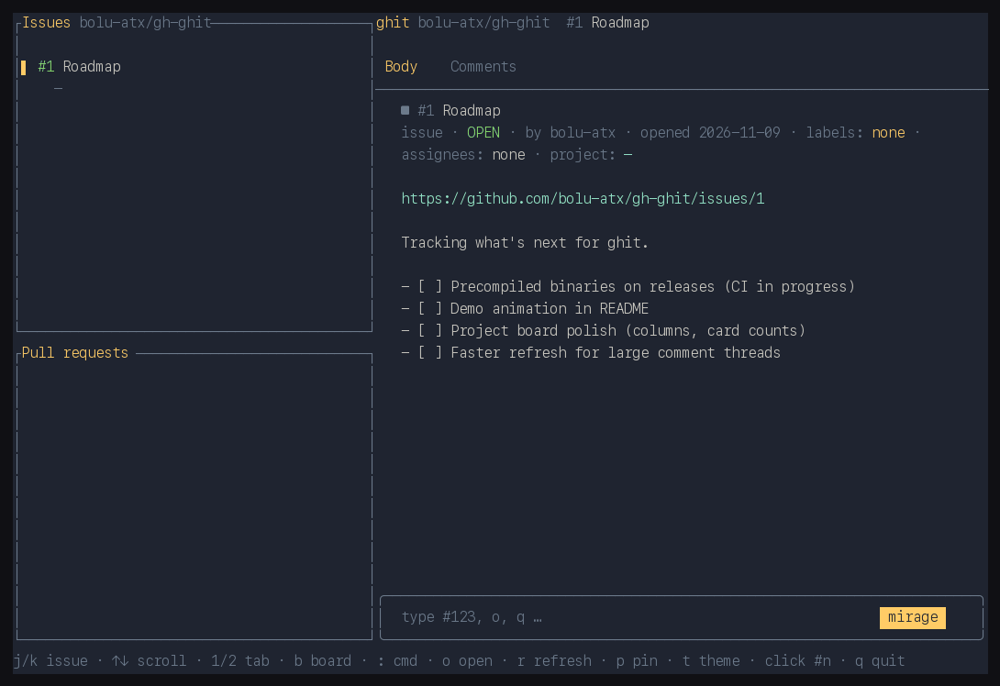

# ghit

ghit is a terminal viewer for GitHub issues and pull requests.
It uses the GitHub API to load issues, PRs, and project boards.



## Why

- Agent swarms and orchestration produce plans faster than any human can read them.
- Triaging that volume in browser tabs takes a toll and does not scale.
- `ghit` keeps issues and plans in one terminal view, so a human can keep up with the agents.

## Requirements

- A terminal and a GitHub token with access to the repository and project.
- For OAuth or classic tokens, ghit checks for `repo`, `read:org`, and `project` scopes.
- Set `GH_TOKEN` or `GITHUB_TOKEN`, or install and authenticate [`gh`](https://cli.github.com) with `gh auth login`.
  ghit checks these token sources in that order.
- `git` is needed to resolve the repository from the current checkout.
  `gh` is needed for its token fallback and the re-authentication dialog.

On an authentication failure, ghit can prompt you to run `gh auth refresh`.
The status bar keeps an auth-degraded badge until re-authentication succeeds.
Press `R` to reopen the prompt.
Environment tokens take precedence over the token from `gh`.

## Install

Install the `gh` extension:

```bash
gh extension install bolu-atx/gh-ghit
gh ghit 241
```

The [releases](https://github.com/bolu-atx/gh-ghit/releases) include binaries for macOS and Linux on arm64 and amd64, and Windows on amd64.
The extension installer selects a release binary for supported platforms.

To build and install with Rust:

```bash
cargo install --git https://github.com/bolu-atx/gh-ghit
ghit 241
```

The repository keeps the `gh-` prefix required by `gh` extensions.
The crate and binary are named `ghit`.

## Usage

```text
ghit [NUMBER...] [-R OWNER/REPO]
gh ghit [NUMBER...] [-R OWNER/REPO]
```

Without `-R` or `--repo`, ghit reads the checkout's `origin` remote with `git`.
Startup numbers open issues or PRs; non-numeric arguments are ignored.
Pins and cached sidebar rows load at startup when available.
Recent rows refresh every five seconds when the UI is idle; failures back off.
`r` refreshes the current item and sidebar.
A window refresh can remove vanished background rows that were not opened or pinned.

The Visual tab shows a PR diff with line numbers or an issue graph.
In a diff, `c` starts a line comment or replies to the review thread under the cursor.
Use `S` to submit a pending review.
The board opens the first Projects v2 project for the repository owner and loads its item pages through GraphQL.
Its filter matches card title, number, or label and can select milestones.

The command bar accepts space-separated numbers, `o [NUMBER]` to open in a browser, and `q` to quit.
Use `--help` for all options.
On Unix, `--drive PATH` serves the UI over a socket without a terminal; `--size WxH` sets its geometry (default `200x50`).

## Shortcuts

Press `?` for the in-app shortcuts modal.

| Context | Keys | Action |
| --- | --- | --- |
| Navigation | `Tab` | Cycle panes |
| Navigation | `j` / `k` | Select |
| Navigation | `↑` / `↓`, Page Up / Page Down | Scroll |
| Navigation | `1` / `2` | Details / Visual tab |
| Navigation | `e` | Toggle refs |
| Navigation | `n` / `N` | Next / previous search match |
| Navigation | `Ctrl+O` / `Ctrl+I` | Back / forward in history |
| Actions | `:` / `/` | Command bar / find |
| Actions | `f` / `b` / `w` | Filter / board / merged-PR window |
| Actions | `o` / `r` / `p` / `y` | Open in browser / refresh / pin / yank |
| Actions | `t` / `q` / `c` | Cycle theme / quit / comment |
| Actions | `a` / `A` / `x` | Sort sidebar / reverse sort / evict row |
| Board | `h` / `l`, `j` / `k` | Move between columns / cards |
| Board | `Space` / `Enter` / `f` | Expand card / open card / filter board |
| Diff | `↑` / `↓`, `J` / `K` | Move by line / file |
| Diff | `Space` / `s` / `S` | Expand file / split view / submit pending review |
| Comment | `c` | Open compose |
| Comment | Emacs keys | Edit the draft |
| Comment | `Ctrl+O` / `Ctrl+S` | Edit in `$EDITOR` / send |
| Shortcuts modal | `Esc` / `?` / `q` | Close |

`Esc` discards a comment draft.
Outside dialogs, `h` / `l` step between neighboring issues and PRs from any pane.
In a focused issue graph, they move between graph nodes instead.
`R` reopens the re-authentication prompt when authentication is degraded.

## Local state and environment

State lives in `$XDG_DATA_HOME/ghit`, or `~/.local/share/ghit` when `XDG_DATA_HOME` is unset.
If neither `XDG_DATA_HOME` nor `HOME` is set, ghit uses `.ghit-data`.

- `pinned-<owner>__<repo>.txt` stores pins for each repository.
- `theme` stores the selected theme.
- `cache/` stores JSON data for 30 minutes. Cache keys include the host.

Set `GH_HOST` for a GitHub Enterprise host; it selects the API endpoints and cache namespace.
Set `EDITOR` to use an external editor for comments.

## Contributing

Bug reports and feature requests are welcome. PRs are welcome for
issues labelled `accepted` or `help wanted`. See
[CONTRIBUTING.md](CONTRIBUTING.md). Report security problems
privately: see [SECURITY.md](SECURITY.md).

## License

MIT. See [LICENSE](LICENSE).
