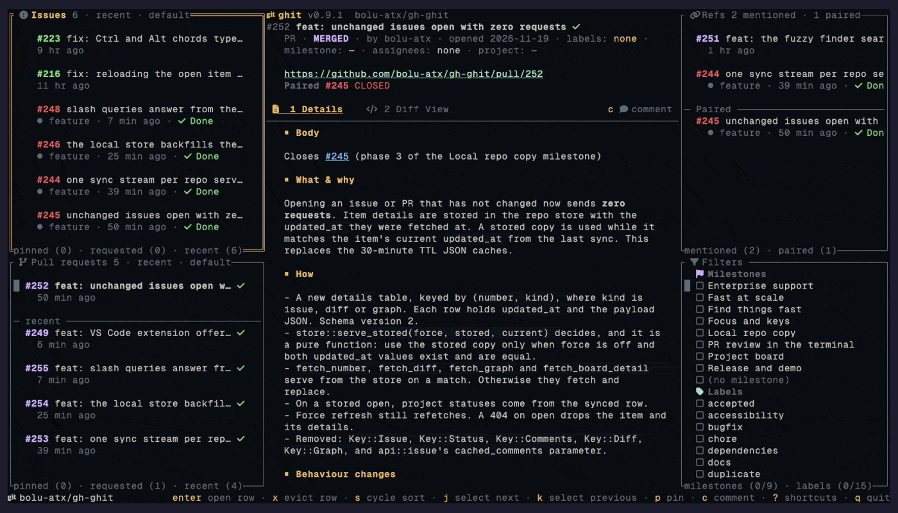

# ghit

ghit is a terminal viewer for GitHub issues and pull requests.
It uses the GitHub API to load issues, PRs, and project boards.
ghit aims for first-class mouse and keyboard support.
Every control should work both ways, and focus and selection should look the same everywhere.



## Why

- Agent swarms and orchestration produce plans faster than any human can read them.
- Triaging that volume in browser tabs takes a toll and does not scale.
- `ghit` keeps issues and plans in one terminal view, so a human can keep up with the agents.

## Requirements

- A terminal and a GitHub token with access to the repository and project.
- For OAuth or classic tokens, ghit checks for `repo`, `read:org`, and `project` scopes.
- Set `GH_TOKEN` or `GITHUB_TOKEN`, or install and authenticate [`gh`](https://cli.github.com) with `gh auth login`.
  ghit checks these token sources in that order.
- `git` is needed to resolve the repository from the current checkout.
  `gh` is needed for its token fallback and the re-authentication dialog.

On an authentication failure, ghit can prompt you to run `gh auth refresh`.
The status bar keeps an auth-degraded badge until re-authentication succeeds.
Press `R` to reopen the prompt.
Environment tokens take precedence over the token from `gh`.

## Install

Install the `gh` extension:

```bash
gh extension install bolu-atx/gh-ghit
gh ghit 241
```

The [releases](https://github.com/bolu-atx/gh-ghit/releases) include binaries for macOS and Linux on arm64 and amd64, and Windows on amd64.
The extension installer selects a release binary for supported platforms.

To build and install with Rust:

```bash
cargo install --git https://github.com/bolu-atx/gh-ghit
ghit 241
```

The repository keeps the `gh-` prefix required by `gh` extensions.
The crate and binary are named `ghit`.

## Usage

```text
ghit [NUMBER...] [-R OWNER/REPO]
gh ghit [NUMBER...] [-R OWNER/REPO]
```

Without `-R` or `--repo`, ghit reads the checkout's `origin` remote with `git`.
Startup numbers open issues or PRs; non-numeric arguments are ignored.
Pins and cached sidebar rows load at startup when available.
Recent rows refresh every 30 seconds when the UI is idle (override with GHIT_AUTO_REFRESH_SECS). A free change check runs first; a full fetch runs only when something changed, or every 5 minutes. Rate-limit errors pause refresh until the quota resets.
`r` refreshes the current item and sidebar.
A window refresh can remove vanished background rows that were not opened or pinned.

The Visual tab shows a PR diff with line numbers, or for an issue a dependency map drawn from the local copy:
issues and PRs linked by blocks, parent and closes links, pulled together by milestone hubs.
It shows the open issue's linked items, or the whole repo (`s`); closed items hide unless they block an open one.
Drag a node to pin it or press `W` `A` `S` `D` to move the selected one, drag empty space or press `h` `j` `k` `l` to pan,
wheel or `+` / `-` to zoom, `0` to fit, `.` / `,` to step nodes, `x` to unpin, and right-click for its menu.
Every other key keeps its global meaning on the map.
A click on a node shows its card at the right: state, milestone, project status, labels, assignees, checks,
last update and the stored body. Its open button, `Enter` or a second click opens the item; `Space` shows or hides the card.
A click on a link, or `e` / `E` on the selected node, shows the link in words with a card for each end; `Esc` closes the card.
`scripts/graph-demo.sh` opens a dense offline demo repo to try it.
In a diff, `c` starts a line comment or replies to the review thread under the cursor.
Use `Ctrl+S` to submit a pending review.
The board opens the first Projects v2 project for the repository owner and loads its item pages through GraphQL.
Its filter matches card title, number, or label and can select milestones.

ghit fetches what you are looking at first: the open issue or PR, then the Issues list, then PRs, then everything else.
Each pane shows its own loading indicator while its data is on the way.
When the rate limit runs out, only the open item keeps loading.
On a narrow terminal the side panes hide so the main pane keeps a readable width.

The command bar accepts space-separated numbers, `o [NUMBER]` to open in a browser, and `q` to quit.
Use `--help` for all options.
On Unix, `--drive PATH` serves the UI over a socket without a terminal; `--size WxH` sets its geometry (default `200x50`).

## Shortcuts

Press `?` for the full, current list.
It starts with the keys of the pane you are in, then lists every other context.
`j` / `k` and the arrow keys scroll it.
The help screen is generated from the same table that handles keys, so it never drifts.

The essentials:

| Keys | Action |
| --- | --- |
| `Tab` / `Shift-Tab` | Cycle panes in screen order (Issues, PRs, Main, Refs, Filters, History) |
| `j` / `k`, `↓` / `↑` | Move: rows, diff lines, cards (scroll the main pane, pan the map) |
| `gg` / `G` | Jump to the top / bottom of any list or scroll area |
| `Ctrl+D` / `Ctrl+U`, Page Down / Page Up | Half page / full page |
| `Enter` | Open the selected row, reference, card or map node; apply in dialogs |
| `Space` | Expand a row, toggle a chip, fold a diff file |
| `[` / `]` | Previous / next issue from any pane |
| `h` / `l` | Fold / unfold tree rows and diff files; pan the map; move between board columns; elsewhere step issues |
| `s` / `S` | Cycle / reverse the sort in Issues and PRs (`s` toggles split in the diff) |
| `a` | In the diff, expand every small file, or fold all when they are open. Large files (over 300 changed lines) stay folded |
| `Ctrl+S` | Submit the pending review |
| `1` / `2` | Details / Visual tab |
| `:` / `/` | Command bar / find. With a sidebar pane focused, `/` filters rows and `n` / `N` step between hits. With Main focused, `/` searches the content (Details, Diff): matches highlight as you type, `Enter` keeps them, smart case |
| `n` / `N` | Next / previous match (wraps). The `‹ 3/12 ›` counter on the Main tab line is clickable. A match in a folded diff file unfolds it |
| `Ctrl+P` | Fuzzy finder: type part of a number or title, `↑` / `↓` or `Ctrl+N` / `Ctrl+P` move, `Enter` opens |
| `f` / `b` / `F` | Format and filter / board / search GitHub |
| `c` | Comment |
| `C` | Close the open issue or PR, or reopen it (asks first) |
| `u` | Undo the last evict or saved-query delete (within 4 s) |
| `m` | Actions menu for the focused row (same as right-click) |
| `Ctrl+O` / `Ctrl+I` | Back / forward in history |
| `Esc` | Back: closes one layer; at the base it clears find and highlight |
| `q` | Close the top dialog; at the base, quit |
| `?` | Shortcuts |

After `g`, the status bar shows `g…` until the next key.

`R` reopens the re-authentication prompt when authentication is degraded.

## Mouse and keyboard

Every action works with the keyboard, and every action has a mouse gesture too.
The only keyboard-only keys are text editing, aliases of another key, and scroll keys the wheel already covers.

- **Click** a pane to focus it, or a row to select it. Click the selected row again, or press `Enter`, to open it.
- **Right-click** a row, reference, card or the Main body for a menu of its actions, with their keys. The repo name in the status bar opens a global menu: refresh, theme, board, help and quit.
- **Wheel** scrolls the pane under the pointer. In the Format dialog and the board filter it moves between fields.
- **Pane titles and footers** are controls: click the sort word to change the sort, its arrow to reverse it, or the list state to open Format.
- **The Main tab line** carries a toolbar for the open item: comment, close or reopen, and on a PR's Diff view the split toggle, expand or fold all files, and file stepping. Close and reopen ask first. Labels drop to icons when the pane is narrow.
- **Dialog footers** are clickable. A click outside a dialog closes it.
- Click a link or `#123` reference in the body to open it.
- Press `?` to see all shortcuts.

## Neovim integration

ghit runs in any Neovim terminal.
On AstroNvim, bind it the same way AstroNvim binds lazygit to `<leader>gg`:

```lua
vim.keymap.set("n", "<Leader>gi", function()
  require("astrocore").toggle_term_cmd { cmd = "ghit", direction = "float" }
end, { desc = "ToggleTerm ghit" })
```

Put the mapping in a file that loads at startup, such as `lua/polish.lua`.
The key toggles the float, so the same key closes it.

With plain [toggleterm.nvim](https://github.com/akinsho/toggleterm.nvim), cache the terminal so each press does not start a new process:

```lua
local ghit = require("toggleterm.terminal").Terminal:new { cmd = "ghit", direction = "float", hidden = true }
vim.keymap.set("n", "<Leader>gi", function() ghit:toggle() end, { desc = "ghit" })
```

Start it from the repository checkout.
ghit resolves `OWNER/REPO` from the `origin` remote.

## Local state and environment

State lives in `$XDG_DATA_HOME/ghit`, or `~/.local/share/ghit` when `XDG_DATA_HOME` is unset.
If neither `XDG_DATA_HOME` nor `HOME` is set, ghit uses `.ghit-data`.

- `pinned-<owner>__<repo>.txt` stores pins for each repository.
- `theme` stores the selected theme.
- `cache/` stores JSON data for 30 minutes. Cache keys include the host.

Set `GH_HOST` for a GitHub Enterprise host; it selects the API endpoints and cache namespace.
Set `EDITOR` to use an external editor for comments.

## Contributing

Bug reports and feature requests are welcome. PRs are welcome for
issues labelled `accepted` or `help wanted`. See
[CONTRIBUTING.md](CONTRIBUTING.md). Report security problems
privately: see [SECURITY.md](SECURITY.md).

## License

MIT. See [LICENSE](LICENSE).
