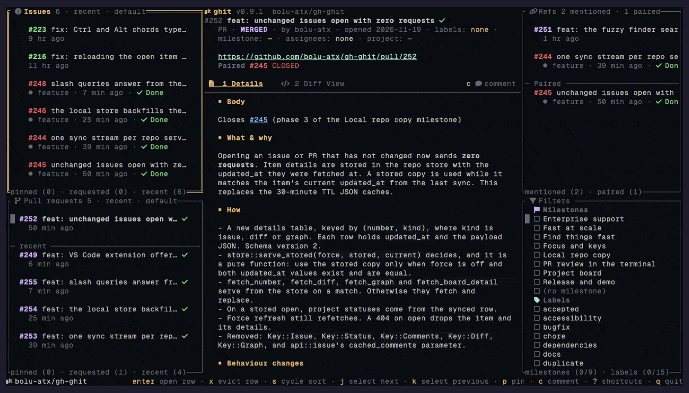

# ghit for VS Code

Read and triage GitHub issues, pull requests, and project boards without leaving the editor.
This extension runs [ghit](https://github.com/bolu-atx/gh-ghit), a fast terminal UI for GitHub, in a VS Code terminal.

## Why

- Agent swarms and orchestration produce plans faster than any human can read them.
- Triaging that volume in browser tabs takes a toll and does not scale.
- ghit keeps issues and plans in one view next to your code, so you can keep up with the agents.

## What you get

- Issues, PRs, and the Projects v2 board for the current repository, in one pane.
- PR diffs with line numbers. Comment on a line, reply to a review thread, and submit the review.
- An issue graph that shows how issues link to each other.
- Full mouse and keyboard support. Every control works both ways.
- Live updates. Recent items refresh in the background with little API cost.

## Get started

1. Install and log in to the [GitHub CLI](https://cli.github.com): `gh auth login`.
   A `GH_TOKEN` or `GITHUB_TOKEN` environment variable also works.
2. Open a folder that is a GitHub checkout.
3. Run **ghit: Open**, click `ghit` in the status bar, or press `Ctrl+Alt+G` (`Cmd+Alt+G` on macOS).

The extension finds ghit in this order: `ghit.path`, your PATH, the downloaded copy.
If none exists, it offers to download the latest release.
Run **ghit: Install / Update Binary** to update it later.

## Settings

- `ghit.location`: `panel` (default) or `editor` for an editor tab.
- `ghit.path`: absolute path to a ghit binary.
